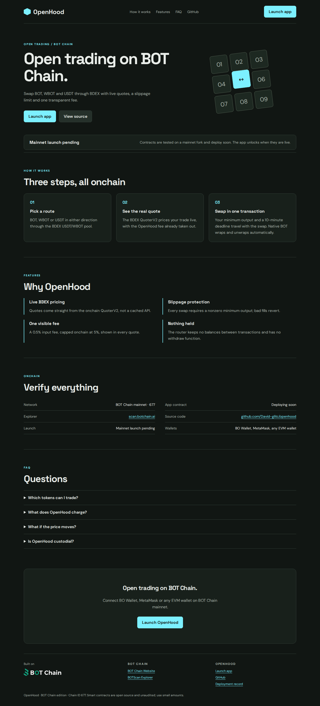

# OpenHood

**Open trading on BOT Chain.** Swap BOT, WBOT and USDT through BDEX with live quotes, a slippage limit and one transparent fee.

**Status:** contracts are tested on a BOT Chain mainnet fork; the mainnet deployment is pending.

- Website and app: https://openhood-botchain.davidopuene8.workers.dev (app at [`/app/`](https://openhood-botchain.davidopuene8.workers.dev/app/))
- Network: BOT Chain mainnet, chain ID 677 · [BOT Chain](https://www.botchain.ai/) · [BOTScan](https://scan.botchain.ai/)



## How it works

1. **Pick a route.** BOT, WBOT or USDT in either direction through the BDEX USDT/WBOT pool.
2. **See the real quote.** The BDEX QuoterV2 prices your trade live, with the OpenHood fee already taken out.
3. **Swap in one transaction.** Your minimum output and a 10-minute deadline travel with the swap. Native BOT wraps and unwraps automatically.

## Features

- **Live BDEX pricing.** Quotes come straight from the onchain QuoterV2, not a cached API.
- **Slippage protection.** Every swap requires a nonzero minimum output; bad fills revert.
- **One visible fee.** A 0.5% input fee, capped onchain at 5%, shown in every quote.
- **Nothing held.** The router keeps no balances between transactions and has no withdraw function.

## Contracts

| Contract | BOT Chain mainnet |
|---|---|
| `OpenHoodRouter` | Pending mainnet deployment |

BOT Chain infrastructure used: USDT `0xaBabc7Ddc03e501d190C676BF3d92ef0e6e87a3C`, WBOT `0xD5452816194a3784dBa983426cCe7c122F4abd30`, BDEX router `0x07032d47A1b9f8460cBeE9dC17c1d3E438693929`, BDEX QuoterV2 `0x034A705b36067cff99ABf5C662Be881cBd8d0176`.

Source: [`contracts/src`](contracts/src). Tests: [`contracts/test`](contracts/test). The contracts are unaudited; use small amounts.

## Develop

Requires Node 20+, [Foundry](https://getfoundry.sh) and Python 3.

```bash
git clone --recursive https://github.com/David-glitc/openhood.git
cd openhood
npm ci
npm test              # forge test
npm run build         # landing page + app into dist/openhood
npm run preview       # http://127.0.0.1:8771
```

`npm run build` writes `dist/openhood/index.html` (landing page), `dist/openhood/app/` (the dApp) and a Cloudflare Workers bundle under `sites/`.

### Wallets

The app discovers installed wallets with EIP-6963 (BO Wallet, MetaMask, OKX, Rabby and others) and falls back to `window.ethereum`. It switches or adds BOT Chain (chain ID `0x2a5`, RPC `https://rpc.botchain.ai`) before any transaction, and simulates every call before asking for a signature.

### Rehearse on a mainnet fork

```bash
anvil --fork-url https://rpc.botchain.ai --port 8677 --chain-id 677
export BOT_RPC_URL=http://127.0.0.1:8677
node scripts/deploy.mjs && node scripts/fork-check.mjs
```

### Deploy

`scripts/deploy.mjs` reads the deployer key from `BOT_SIGNER_FILE` (default `~/.config/botchain-wave1/deployer.env`, never committed), refuses to broadcast on mainnet without `BOT_MAX_GAS_BOT`, and journals every transaction to `deployments/mainnet.json` so it can resume. `python3 scripts/publish.py` publishes the site with a one-hour, Workers-only Cloudflare token and revokes it afterwards.

## License

MIT. Built on [BOT Chain](https://www.botchain.ai/).
